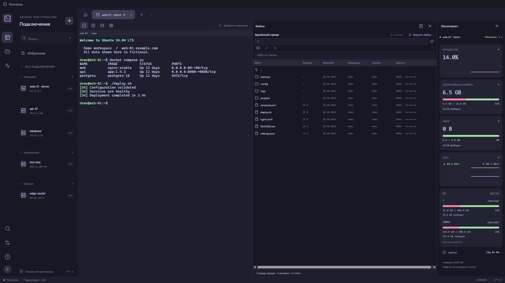
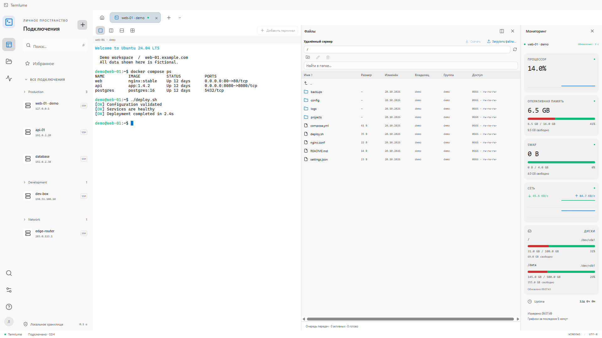

<div align="center">
  
  <h1>Termlume</h1>
  <p>SSH, файлы и мониторинг серверов — в одном окне.</p>
  <p>
    <a href="https://github.com/Termlume/Termlume/releases"></a>
    <a href="#coffee"></a>
  </p>
  <p><b>0.1 Alpha</b> · Windows 10/11 · Интерфейс на русском языке</p>
</div>



### Что умеет

- SSH, Telnet, WSL, PowerShell и cmd. Вкладки, избранное и разделение рабочей области.
- Передача файлов через SFTP с резервным SCP; отдельный доступ к файлам WSL и локальной оболочки.
- Перетаскивание файлов между сервером и Проводником, открытие в выбранном редакторе и обратная загрузка сохранений.
- Права доступа, владелец и группа; сортировка, изменение ширины столбцов и контекстное меню.
- CPU, RAM, swap, диски и сеть Linux-серверов. Настраиваемый интервал обновления.
- Catppuccin, VS Code, Tokyo Night и One Dark; переназначение горячих клавиш.
- Локальное хранение данных, защищённые пароли и импорт/экспорт резервной копии.

<details>
<summary>Светлая тема</summary>



</details>

### Установка

Скачайте `Termlume-Setup-…-x64.exe` из [Releases](https://github.com/Termlume/Termlume/releases) и установите приложение. WSL устанавливается отдельно, если вы планируете им пользоваться.

Это ранний alpha-выпуск. Установщик пока без цифровой подписи. Рекурсивная передача папок и возобновление прерванных загрузок пока не поддерживаются; Telnet сам по себе не предоставляет файлового канала.

### Обновления и данные

Новые версии появляются в приложении автоматически. В настройках можно проверить обновления вручную и выбрать стабильный либо предварительный канал. Скачивание и перезапуск выполняются по вашей команде; переход между каналами не устанавливает более старую версию.

Данные хранятся отдельно от программы, в `%APPDATA%\Terminal`. Это имя каталога сохранено для совместимости с первыми версиями. Обновление не удаляет подключения, настройки или пароли. Секреты защищены средствами Windows и привязаны к вашей учётной записи. Для переноса на другой компьютер используйте зашифрованный экспорт из настроек.

На скриншотах — изолированный демонстрационный профиль и тестовый сервер.

### Разработка

Windows, Node.js 22.12+ и npm; для сборки C#-помощника используется установленный .NET Framework.

```sh
npm ci
npm run dev
npm run typecheck
npm test
npm run dist:win
```

[Как выпустить версию](docs/RELEASING.md) · [Сообщить об ошибке](https://github.com/Termlume/Termlume/issues/new?template=bug_report.yml)

<a id="coffee"></a>

### На кофе :)

Если Termlume пригодился и хочется поддержать разработку:

| Сеть             | Адрес                                              |
| ---------------- | -------------------------------------------------- |
| Ethereum / ERC20 | `0x9a3C0E1bbfe4012CB74B26bb87885F4A3273432D`       |
| TON              | `UQBlqyl-R3_2G41y19kQX-z6i6ouWQwBq5SQ-OF0ci9t_hLG` |
| Bitcoin          | `bc1q7d27puu22r8q3vnmdsqfuqh65qtflezysqhxet`       |

### Лицензии

Права на Termlume сохраняются за авторами; отдельная открытая лицензия на исходники пока не объявлена. Лицензии сторонних компонентов поставляются вместе с приложением в `THIRD_PARTY_NOTICES.txt` и каталоге `licenses`.
