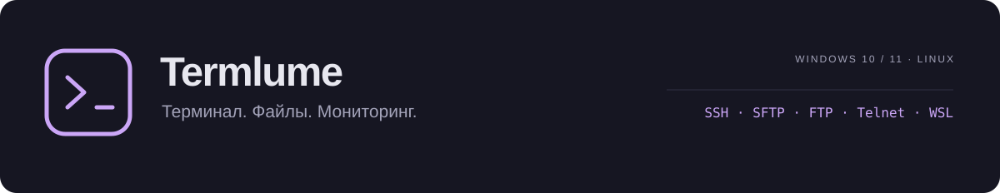
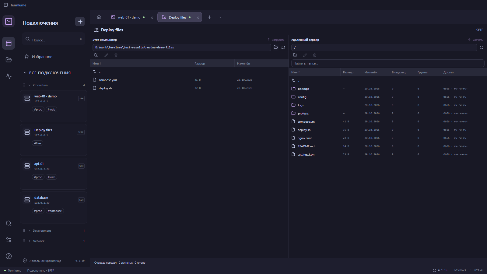
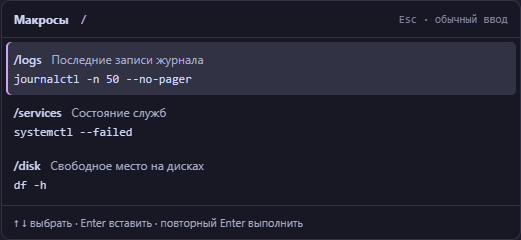

<div align="center">
  <picture>
    <source media="(prefers-color-scheme: light)" srcset="docs/images/cover-light.svg" />
    
  </picture>

  <p><strong>SSH-клиент для Windows и Linux, в котором всё рядом.</strong><br />
  Сессии, файлы и состояние сервера — в одной рабочей области.</p>

  <p>
    <a href="https://github.com/Termlume/Termlume/releases/latest"></a>
    
    
    
    <a href="LICENSE"></a>
  </p>

  <p>
    <a href="https://github.com/Termlume/Termlume/releases/latest"><strong>Windows x64</strong></a>
    &nbsp; · &nbsp; <a href="https://github.com/Termlume/Termlume/releases/download/v0.2.3/Termlume-0.2.3-linux-amd64.deb"><strong>Linux · DEB</strong></a>
    &nbsp; · &nbsp; <a href="https://github.com/Termlume/Termlume/releases/download/v0.2.3/Termlume-0.2.3-linux-x86_64.AppImage">AppImage</a>
    &nbsp; · &nbsp; <a href="CHANGELOG.md">Что нового</a>
    &nbsp; · &nbsp; <a href="https://github.com/Termlume/Termlume/issues/new?template=bug_report.yml">Сообщить об ошибке</a>
    &nbsp; · &nbsp; <a href="#coffee">На кофе :)</a>
  </p>
</div>

<picture>
  <source media="(prefers-color-scheme: light)" srcset="docs/images/overview-light.png" />
  
</picture>

<p align="center"><sub>Реальный интерфейс 0.2.1b. На всех снимках — демонстрационные подключения и файлы.</sub></p>

## Всё для работы с сервером

| Сессии и подключения | Работа с файлами |
| :--- | :--- |
| SSH, Telnet и локальный терминал. В Windows — также WSL, PowerShell и cmd. Вкладки и изменяемые сплиты. | Вкладки SFTP и FTP/FTPS. Файловый браузер рядом с терминалом. |
| Избранное, теги с поиском по `#prod`, сворачиваемые группы и их перестановка. | Перенос файлов и папок, включая SFTP → Nautilus и рабочий стол в Linux. Открытие в редакторе и загрузка сохранённых изменений на сервер. |
| Макросы по `/` и переназначение горячих клавиш. | Права, владелец и группа, контекстное меню, сортировка и адаптивные столбцы. |

### Подключения и учётные данные

- SSH с паролем, приватным ключом или SSH-агентом. Поддерживаются ключи с passphrase; в Linux работают пути `~/.ssh/` и системный `ssh-agent`.
- Общие учётные данные для нескольких серверов: один логин и пароль или ключ можно связать с группой подключений. Записи можно именовать, редактировать и объединять.
- Избранное, группы с перетаскиванием и кликабельные теги. Например, `#prod`, `#dev` и `#database` помогают быстро отфильтровать список.
- Контроль ключа сервера при подключении и предупреждение при его изменении.
- В Windows — выбор установленного дистрибутива WSL. В Linux — локальная оболочка пользователя.

### Терминал и рабочее пространство

- Несколько вкладок и сплиты: рядом, друг под другом или сеткой. Панели можно менять местами и растягивать.
- Масштабирование через Ctrl+колесо, в том числе в `nano` и других полноэкранных программах.
- Настраиваемое копирование и вставка: копирование выделенного текста и вставка правой кнопкой либо привычное контекстное меню.
- Предпросмотр многострочной вставки: проверьте и отредактируйте команды перед отправкой на сервер. Для одной строки окно не появляется.
- Catppuccin, VS Code, Tokyo Night и One Dark: светлые и тёмные темы для интерфейса и терминала.

### Файлы и удалённое редактирование

- SFTP и FTP/FTPS в отдельных вкладках; файловый браузер также можно открыть рядом с терминалом. Доступны удалённая панель или двухпанельный режим с локальными файлами.
- Загрузка и скачивание файлов и папок с вложениями. Перетаскивание из SFTP в Проводник Windows, Nautilus и на рабочий стол Linux; в Linux содержимое запрашивается при копировании, а не при наведении или выделении.
- Двойной щелчок открывает папку или файл в приложении по умолчанию. Сохранённые изменения файла отправляются обратно на сервер; при конфликте с изменённой серверной копией приложение спрашивает, как продолжить.
- Переименование, удаление, создание папок, копирование пути и контекстное меню. Таблица поддерживает сортировку и изменение ширины столбцов.
- Просмотр и изменение владельца, группы и прав доступа: отдельные флажки чтения, записи и выполнения с синхронным числовым режимом.
- Очередь передач с прогрессом и отменой, запрос перезаписи существующих файлов, выбор папки скачивания и переход вслед за текущей папкой терминала.

### Мониторинг серверов

- CPU, оперативная память, swap, диски, входящий и исходящий трафик, время работы и температуры — если сервер предоставляет эти данные.
- Подключённые пользователи, процессы, TCP-соединения, файловые дескрипторы и сетевые диски NFS.
- Боковая панель с графиками или компактная строка под терминалом. По наведению доступны подробности; каждый диск отображается отдельно.
- Настраиваемый интервал опроса, общий порядок показателей и отдельный набор включённых показателей для каждого сервера.
- Работает для Linux по SSH и для WSL в Windows. Дополнительный агент на сервер устанавливать не нужно; набор доступных метрик зависит от системы и прав пользователя.

### Команды, подсветка и журналы

- Макросы и библиотека команд с поиском и категориями. `/` в начале строки открывает список; выбранная команда сначала вставляется, а не выполняется автоматически.
- Готовые правила подсветки и конструктор собственных правил: слова, регистр, цвет и подсветка всей строки. Для сложных случаев доступны регулярные выражения.
- Журналы сеансов: ручная или автоматическая запись для выбранных подключений, просмотр, поиск, экспорт и закрепление важных записей. Размер и срок хранения ограничиваются в настройках.
- Переназначаемые горячие клавиши. По умолчанию: `Ctrl+W` — закрыть вкладку, `Ctrl+Tab` — следующая, `Ctrl+Shift+N` — новое подключение, `Ctrl+Alt+T` — локальный терминал.

### Графические приложения по SSH

X11 forwarding позволяет открывать графические приложения сервера на локальном компьютере. В Windows встроенный X-сервер запускается по необходимости; в Linux используется доступный локальный X-сервер, в том числе XWayland. Перенаправление включается отдельно для каждого SSH-подключения. На сервере нужны `xauth` и разрешённый `X11Forwarding`.

## Посмотреть ближе

<details>
<summary><strong>Файловый клиент — локальная и удалённая стороны</strong></summary>

Отдельная вкладка для передачи файлов. Права, владелец и группа отображаются в таблице; действия доступны по правому клику.



</details>

<details>
<summary><strong>Библиотека команд — частые команды под рукой</strong></summary>

Введите `/` в начале команды, найдите нужную запись и выберите её. Команда сначала вставляется в терминал; повторный Enter запускает её. В библиотеке доступны поиск, категории, готовые примеры и привязка к подключениям.



</details>

<details>
<summary><strong>Светлая тема</strong></summary>


</details>

## Установка и обновления

| Платформа | Установка | Обновления |
| :--- | :--- | :--- |
| **Windows 10/11 x64** | Установщик `Termlume-Setup-…-x64.exe` из [последнего выпуска](https://github.com/Termlume/Termlume/releases/latest). | Проверка каждый час, загрузка и установка из приложения. |
| **Linux x86_64** | [DEB 0.2.3](https://github.com/Termlume/Termlume/releases/download/v0.2.3/Termlume-0.2.3-linux-amd64.deb). Проверен в Ubuntu 24.04 с GNOME/Wayland. | Проверка каждый час, загрузка и установка из приложения. Для DEB потребуется системное подтверждение прав администратора. |

Для Linux установите скачанный пакет с зависимостями:

```sh
sudo apt install ./Termlume-0.2.3-linux-amd64.deb
```

[Подробнее о Linux](docs/LINUX.md): SSH-ключи, хранилище паролей и сборка из исходников. В Debian 13 проверены зависимости и загрузка файлового компонента; полная проверка интерфейса ещё не выполнена. AppImage доступен как экспериментальный вариант и отдельно пока не проверен.

**Сейчас оба канала предлагают 0.2.3.** Основной канал получает публичные выпуски; предварительный также допускает тестовые версии, когда они появляются, и включает актуальную стабильную версию. Канал выбирается в настройках; переключение не понижает установленную версию.

<details>
<summary>О текущей бете</summary>

Установщик Windows пока без цифровой подписи. Продолжение передачи после обрыва и объединение существующих папок пока не поддерживаются. Telnet сам по себе не предоставляет файлового канала.

</details>

## Ваши данные остаются у вас

Подключения и настройки хранятся локально. Пароли защищены средствами Windows или системного хранилища секретов Linux, например GNOME Keyring. Для использования Termlume не нужна учётная запись в облачном сервисе.

Обновление приложения сохраняет подключения, пароли и настройки. Для резервной копии и переноса на другой компьютер есть зашифрованный экспорт и импорт в настройках.

<details>
<summary>Где хранятся данные</summary>

- Windows: `%APPDATA%\Terminal` — каталог сохранён для совместимости с первыми версиями.
- Linux: `~/.config/Termlume/`.

Для переноса между системами используйте зашифрованный экспорт и импорт. Приватные SSH-ключи не копируются в архив: перенесите их отдельно и обновите пути.

</details>

## Исходный код

[`main`](https://github.com/Termlume/Termlume/tree/main) содержит исходники опубликованной Windows-версии. Исходники Linux-порта 0.2.3 доступны в ветке [`linux`](https://github.com/Termlume/Termlume/tree/linux) и [отдельным архивом в релизе](https://github.com/Termlume/Termlume/releases/download/v0.2.3/Termlume-0.2.3-linux-source.tar.gz). Тег `v0.2.3` сохранён без изменений.

<a id="coffee"></a>

## На кофе :)

Если Termlume помогает в работе, можно поддержать его развитие.

<details>
<summary><strong>Показать адреса для поддержки</strong></summary>

| Сеть | Адрес |
| :--- | :--- |
| Ethereum / ERC20 | `0x9a3C0E1bbfe4012CB74B26bb87885F4A3273432D` |
| TON | `UQBlqyl-R3_2G41y19kQX-z6i6ouWQwBq5SQ-OF0ci9t_hLG` |
| Bitcoin | `bc1q7d27puu22r8q3vnmdsqfuqh65qtflezysqhxet` |

</details>

---

## Лицензия

Termlume распространяется под **GNU General Public License версии 3 или любой более поздней версии** (`GPL-3.0-or-later`). Полный текст — в [LICENSE](LICENSE), уведомление об условиях — в [NOTICE](NOTICE).

Программа предоставляется **без гарантий**, включая гарантии пригодности для конкретной цели. Ограничения гарантий и ответственности действуют в пределах применимого закона; подробности приведены в разделах 15–17 лицензии.

Права на Termlume сохраняются за авторами. Сторонние компоненты распространяются на условиях собственных лицензий; их тексты поставляются с приложением в `THIRD_PARTY_NOTICES.txt` и каталоге `licenses`.
